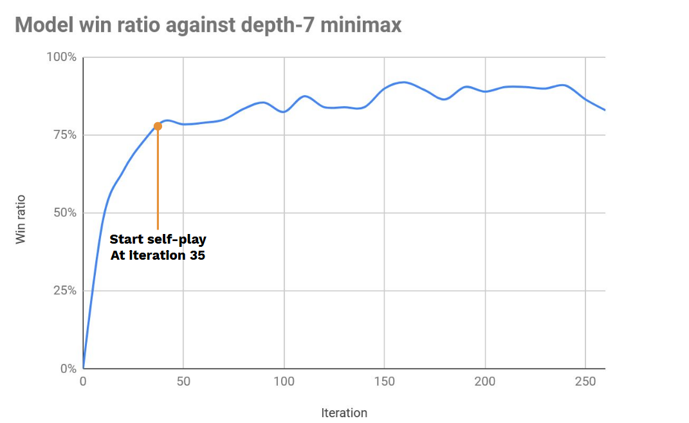

# CU Makhos

Implementación de aprendizaje por refuerzo para las Damas Tailandesas basada en los métodos de AlphaGo (supervisado + refuerzo), ya que no logré implementar el modelo de conocimiento cero en el primer intento (probablemente por problemas de hiperparámetros, dado que el RL es propenso a ello).

La implementación utiliza Python y Pytorch. Está basada en el framework [alpha-zero-general](https://github.com/suragnair/alpha-zero-general), por lo que puedes implementar fácilmente otras variantes de damas.

Si planeas entrenar tu propio modelo o mejorar el incluido, echa un vistazo a `main_th_checkers.py` (esta es una solución/implementación ad-hoc para mi entorno y configuración de hardware).

### Cómo jugar

Para jugar contra el modelo, necesitas tener instalados Python y CUDA.

```
python human_ui.py
```

### Modelo preentrenado

La última iteración de mi ejecución es la 268, donde las primeras 35 iteraciones aprendieron del juego del algoritmo minimax y el resto fue mediante auto-juego (self-play) de la iteración más reciente en ese momento.



El rendimiento del modelo se estimó como resultado total en una partida de 200 juegos contra el algoritmo minimax de profundidad 7, utilizando 200 simulaciones de búsqueda de árbol Monte Carlo por cada movimiento.

La búsqueda del modelo es aproximadamente 10 veces más eficiente que el minimax de profundidad 7 en términos de simulaciones de movimiento.

### Agradecimientos

- [alpha-zero-general](https://github.com/suragnair/alpha-zero-general)
- [chess-alpha-zero](https://github.com/Zeta36/chess-alpha-zero)
- [pytorch-classification](https://github.com/bearpaw/pytorch-classification) y [progress](https://github.com/verigak/progress).
- [alpha-nagibator](https://github.com/evg-tyurin/alpha-nagibator)
